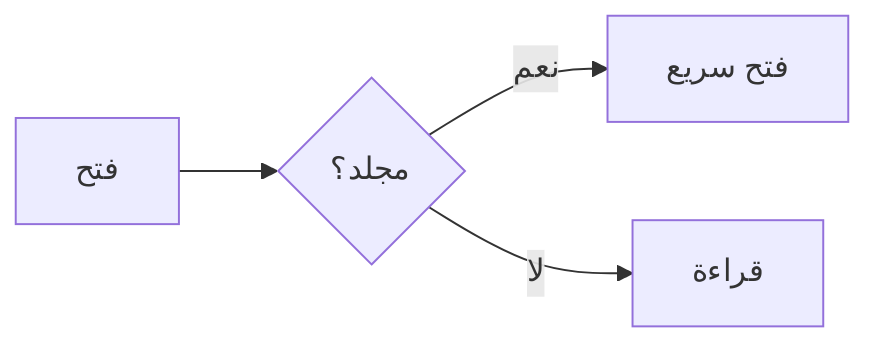

# مرحباً بك في قارئ

**قارئ** تطبيق لقراءة ملفات ماركداون، صُمّم ليكون **عربياً أولاً** مع دعم كامل للإنجليزية. كل فقرة تختار اتجاهها بنفسها، لذلك يمكنك المزج بين اللغتين بحرية.


## لماذا قارئ؟

- واجهة هادئة بلا شريط جانبي — المحتوى أولاً.
- خطوط عربية مختارة: نوتو سانس، تجوّل، روبيك، آي بي إم بلكس، فزيرمتن.
- يدعم **الجداول** و*المعادلات* و`الشيفرة` والمخططات.
- ينتقل بين الملفات عبر الروابط: اقرأ [دليل الاستخدام](guide/usage.md) أو [English sample](english.md).

> القراءة غذاء العقل، والكتاب خير جليس في الأنام.

> [!TIP]
> اضغط <kbd>⌘</kbd> + <kbd>P</kbd> للبحث السريع بين ملفات المجلد.

> [!WARNING]
> هذا تنبيه للتجربة — يظهر بلون مختلف حسب نوعه.

### قائمة مهام

- [x] فتح ملف أو مجلد
- [x] دعم الاتجاه من اليمين إلى اليسار
- [ ] كتابة المزيد من المستندات

### جدول

| الخط | النوع | ملاحظة |
|---|---|---|
| نوتو سانس | متغيّر | الخط الافتراضي |
| تجوّل | ثابت | عصري وخفيف |
| IBM Plex Sans Arabic | ثابت | Pairs with Plex Sans |

### شيفرة

```ts
// الشيفرة دائماً من اليسار إلى اليمين
export function greet(name: string) {
  return `مرحباً، ${name}!`;
}
```

### معادلة

المعادلة الشهيرة $E = mc^2$ تظهر داخل السطر، وهذه في سطر مستقل:

$$
\int_0^\infty e^{-x^2}\,dx = \frac{\sqrt{\pi}}{2}
$$

### مخطط



هذه جملة تحتوي على حاشية[^1].

[^1]: الحواشي تظهر في أسفل المستند.
